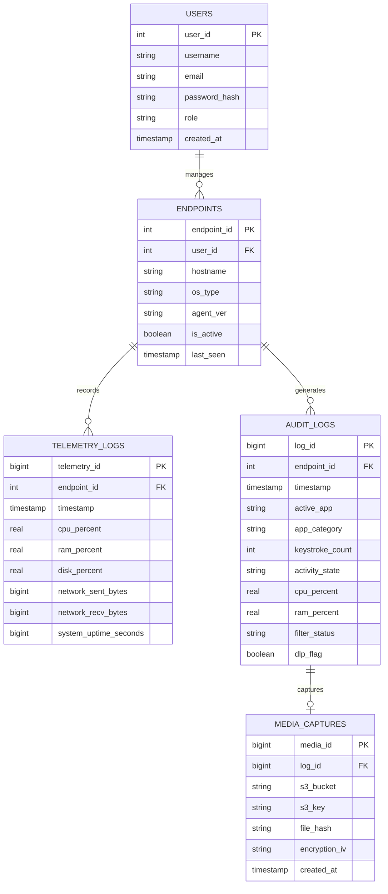

# EDMT Relational Database (Amazon RDS PostgreSQL)

This directory contains the database definition files, relational schemas, performance indices, and data initialization scripts for the **Privacy-Centric Endpoint Observability System (EDMT)**, hosted on **Amazon RDS PostgreSQL**.

---

## 🏛️ Entity-Relationship Architecture



---

## 📋 Table Definitions (`schema.sql`)

### 1. `users`
Stores authorized administrative and compliance auditor accounts.
- `role`: Supports `'Admin'` (full configuration, kicking, and telemetry controls) and `'Auditor'` (read-only compliance access).
- Passwords are encrypted using standard PBKDF2/SHA-256 password hashing.

### 2. `endpoints`
Maintains the registry of all workstations that have granted explicit monitoring consent.
- `hostname`: The workstation computer name.
- `is_active`: Boolean flag indicating if the endpoint is authorized.
- `last_seen`: Timestamp with time zone of the most recent heartbeat.

### 3. `telemetry_logs`
Chronological time-series performance metrics.
- Records CPU, RAM, Disk, and Network bandwidth utilization per endpoint cycle.

### 4. `audit_logs`
Core compliance event trail capturing foreground application focus, typing rates, and privacy filtration states.
- `activity_state`: `'Active'` or `'Privacy_Suspended'`.
- `filter_status`: Categorizes privacy decisions (`'Clean'`, `'Title_Blacklisted'`, `'Password_Control_Suppressed'`, `'User_Suspended'`).
- `dlp_flag`: True when local pattern redaction or privacy suspension was triggered.

### 5. `media_captures`
Metadata references for encrypted display captures stored in Amazon S3.
- `s3_key`: Object key location in the S3 bucket (`screenshots/{endpoint_id}/{log_id}.enc`).
- `file_hash`: SHA-256 integrity digest of the encrypted payload.
- `encryption_iv`: Hex-encoded 96-bit initialization vector required for AES-256-GCM authenticated decryption.

---

## ⚡ Performance Indices

To support sub-50ms dashboard response times over large fleets, the following composite indices are defined in `schema.sql`:

```sql
CREATE INDEX IF NOT EXISTS idx_telemetry_logs_endpoint_timestamp ON telemetry_logs(endpoint_id, timestamp DESC);
CREATE INDEX IF NOT EXISTS idx_audit_logs_endpoint_timestamp ON audit_logs(endpoint_id, timestamp DESC);
CREATE INDEX IF NOT EXISTS idx_audit_logs_filter_status ON audit_logs(filter_status);
CREATE INDEX IF NOT EXISTS idx_media_captures_log_id ON media_captures(log_id);
```

---

## 🚀 Database Administration & Connection

### Connecting to Amazon RDS
Connect to the database instance using `psql`:

```bash
psql -h <YOUR_RDS_ENDPOINT>.us-east-1.rds.amazonaws.com \
     -U postgresadmin \
     -d postgres
```

### Initializing Database Schema
Apply the complete schema:

```bash
psql -h <YOUR_RDS_ENDPOINT>.us-east-1.rds.amazonaws.com \
     -U postgresadmin \
     -d postgres \
     -f database/schema.sql
```

### Applying Seeds & Data Cleanup
Execute `database/seed.sql` to initialize default administrator accounts and clean up any historical mock endpoints:

```bash
psql -h <YOUR_RDS_ENDPOINT>.us-east-1.rds.amazonaws.com \
     -U postgresadmin \
     -d postgres \
     -f database/seed.sql
```

