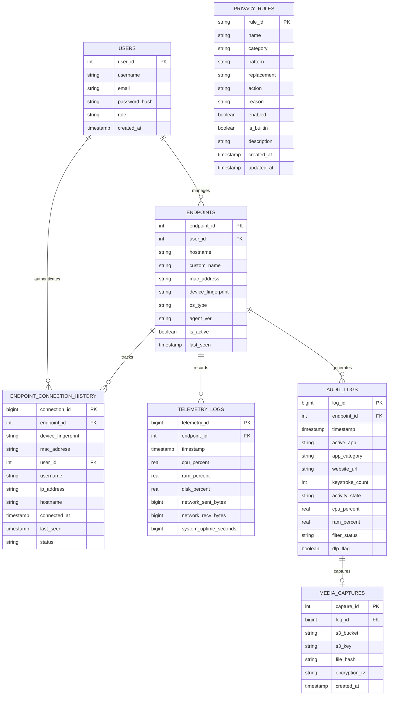

# SecureSight Relational Database (Amazon RDS PostgreSQL)

This directory contains the relational database definition files, schema migrations, performance indices, and data initialization scripts for the **SecureSight Endpoint Observability Platform**, hosted on **Amazon RDS PostgreSQL** (compatible with PostgreSQL 15+).

---

## 🏛️ Entity-Relationship Architecture



---

## 📋 Table Definitions (`schema.sql`)

### 1. `users`
Stores authorized administrative and compliance auditor accounts.
- `user_id`: Primary auto-incrementing key.
- `username` / `email`: Unique administrative identities.
- `password_hash`: Standard salted PBKDF2/SHA-256 password hashes.
- `role`: Supports `'Admin'` (full configuration, endpoint deletion/renaming, and telemetry controls), `'Auditor'` (read-only compliance access), and `'User'`.

### 2. `endpoints`
Maintains the registry of enrolled workstations that have granted monitoring consent.
- `endpoint_id`: Primary workstation identifier.
- `user_id`: References `users(user_id)` with `ON DELETE SET NULL`.
- `hostname`: Machine network hostname.
- `custom_name`: Optional admin-assigned alias (configured via `PATCH /api/v1/endpoints/{id}/rename`).
- `mac_address` & `device_fingerprint`: Workstation hardware identity for seamless auto-reconnect and re-registration after accidental deletion.
- `os_type` / `agent_ver`: Client operating system platform and installed agent version.
- `is_active`: Operational state flag (updated to `false` when paused or kicked).
- `last_seen`: Timestamp with timezone of the latest agent heartbeat.

### 3. `endpoint_connection_history`
Preserves an immutable historical audit trail of endpoint connection sessions, logins, and IP associations.
- Foreign key to `endpoints(endpoint_id)` with `ON DELETE CASCADE`.
- Captures `device_fingerprint`, `mac_address`, `username`, `ip_address`, `connected_at`, `last_seen`, and status (`'Online'`, `'Offline'`).

### 4. `telemetry_logs`
Chronological time-series performance metrics polled at 5-second intervals.
- `telemetry_id`: High-volume auto-incrementing 64-bit identifier (`BIGSERIAL`).
- Foreign key to `endpoints(endpoint_id)` with `ON DELETE CASCADE`.
- Records instantaneous `cpu_percent`, `ram_percent`, `disk_percent`, cumulative `network_sent_bytes` / `network_recv_bytes`, and total `system_uptime_seconds`.

### 5. `audit_logs`
High-fidelity foreground compliance trail capturing active application windows, browser URLs, typing rates, and DLP decisions.
- `log_id`: High-volume auto-incrementing 64-bit identifier (`BIGSERIAL`).
- Foreign key to `endpoints(endpoint_id)` with `ON DELETE CASCADE`.
- `active_app`: Process executable or foreground window title.
- `app_category`: Heuristic classification (e.g., `'Development'`, `'Browsing'`, `'Productivity'`).
- `website_url`: Domain or active browser tab URL (if extracted).
- `keystroke_count`: Number of keystrokes typed within the polling cycle.
- `activity_state`: `'Active'`, `'Idle'`, or `'Privacy_Suspended'`.
- `filter_status`: Categorizes privacy engine actions (`'Clean'`, `'Title_Blacklisted'`, `'Password_Control_Suppressed'`, `'User_Suspended'`, `'DLP_Redacted'`).
- `dlp_flag`: Boolean set to `true` whenever sensitive patterns (SSN, credit card, passwords) were intercepted.

### 6. `media_captures`
Encrypted screenshot metadata references linked to S3 object storage.
- `capture_id`: Primary identifier.
- `log_id`: References `audit_logs(log_id)` with `ON DELETE CASCADE`.
- `s3_bucket`: S3 target bucket name.
- `s3_key`: S3 object key path (`screenshots/{endpoint_id}/{log_id}.enc`).
- `file_hash`: SHA-256 digest of the raw encrypted payload for cryptographic integrity verification.
- `encryption_iv`: Hex-encoded 96-bit initialization vector for authenticated **AES-256-GCM** decryption.

### 7. `privacy_rules`
Dynamic database-backed privacy and data loss prevention (DLP) rules evaluated in real time.
- `rule_id`: Unique identifier (e.g., `ssn_redaction`, `credit_card_mask`).
- `name`: Human-readable rule title.
- `category`: Classification (`PII`, `Financial`, `Credentials`, `Sensitive`, `Custom`).
- `pattern`: Regular expression pattern used to detect sensitive substrings.
- `replacement`: Replacement mask string (default: `[REDACTED]`).
- `action`: Enforcement action (`mask_and_block`, `mask_only`, `block_only`).
- `reason`: Compliance rationale recorded in audit logs.
- `enabled`: Boolean toggle for immediate runtime activation/deactivation.
- `is_builtin`: Protects core baseline privacy rules from inadvertent deletion.

---

## ⚡ Performance Indices

To support sub-50ms dashboard response times over high-throughput enterprise fleets, the following composite indices are defined in `schema.sql`:

```sql
-- Hardware identity and reconnect lookups
CREATE INDEX IF NOT EXISTS idx_endpoints_device_fingerprint ON endpoints(device_fingerprint);
CREATE INDEX IF NOT EXISTS idx_endpoints_mac_address ON endpoints(mac_address);
CREATE INDEX IF NOT EXISTS idx_conn_hist_fingerprint ON endpoint_connection_history(device_fingerprint);
CREATE INDEX IF NOT EXISTS idx_conn_hist_mac ON endpoint_connection_history(mac_address);
CREATE INDEX IF NOT EXISTS idx_conn_hist_endpoint ON endpoint_connection_history(endpoint_id);
CREATE INDEX IF NOT EXISTS idx_conn_hist_user ON endpoint_connection_history(user_id);

-- Time-series telemetry and audit querying
CREATE INDEX IF NOT EXISTS idx_telemetry_logs_endpoint_timestamp ON telemetry_logs(endpoint_id, timestamp DESC);
CREATE INDEX IF NOT EXISTS idx_audit_logs_endpoint_timestamp ON audit_logs(endpoint_id, timestamp DESC);
CREATE INDEX IF NOT EXISTS idx_audit_logs_filter_status ON audit_logs(filter_status);
CREATE INDEX IF NOT EXISTS idx_audit_logs_website_url ON audit_logs(website_url);

-- Encrypted capture foreign key lookup
CREATE INDEX IF NOT EXISTS idx_media_captures_log_id ON media_captures(log_id);

-- Dynamic privacy rule lookups
CREATE INDEX IF NOT EXISTS idx_privacy_rules_category ON privacy_rules(category);
CREATE INDEX IF NOT EXISTS idx_privacy_rules_enabled ON privacy_rules(enabled);
```

---

## 🚀 Database Administration & Connection

### Connecting to Amazon RDS
Connect securely to the RDS PostgreSQL instance using `psql`:

```bash
psql -h <YOUR_RDS_ENDPOINT>.us-east-1.rds.amazonaws.com \
     -U postgresadmin \
     -d postgres
```

### Initializing Database Schema
Apply the complete relational schema with cascading foreign keys:

```bash
psql -h <YOUR_RDS_ENDPOINT>.us-east-1.rds.amazonaws.com \
     -U postgresadmin \
     -d postgres \
     -f database/schema.sql
```

### Applying Seeds & Data Cleanup
Execute `database/seed.sql` to initialize default administrator accounts and seed baseline privacy rules:

```bash
psql -h <YOUR_RDS_ENDPOINT>.us-east-1.rds.amazonaws.com \
     -U postgresadmin \
     -d postgres \
     -f database/seed.sql
```
