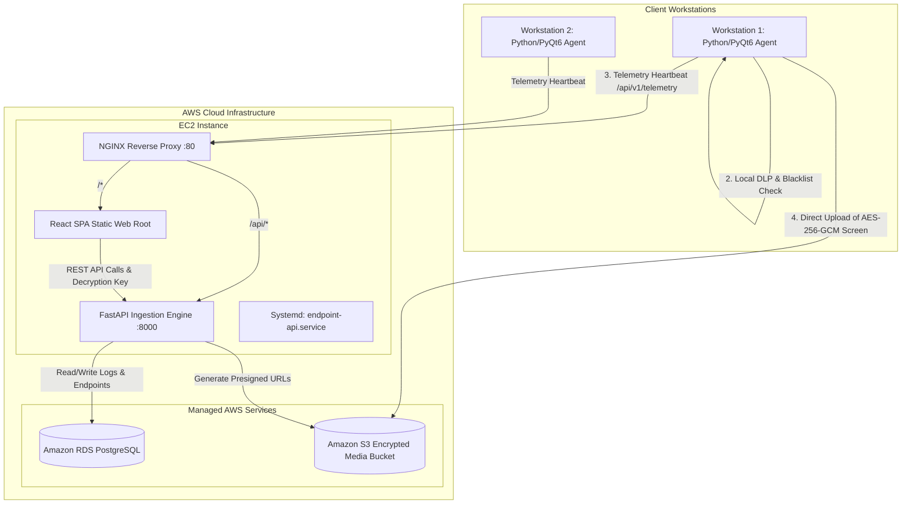

# Privacy-Centric Endpoint Observability & Monitoring System (EDMT)

A cloud-native, privacy-first cybersecurity telemetry and endpoint observability platform engineered for enterprise compliance auditing and threat monitoring without compromising end-user privacy. Designed and optimized for cost-effective deployment on **AWS Free Tier** architecture.

---

## 📌 Executive Summary

Modern cybersecurity operations require continuous visibility into workstation activity, process execution, and data movement to prevent insider threats and data leakage. However, traditional monitoring tools often invade user privacy by capturing credentials, personal communications, and sensitive financial records without discrimination or explicit user consent.

The **Privacy-Centric Endpoint Observability System (EDMT)** bridges this critical gap by implementing:
1. **Client-Side Data Loss Prevention (DLP)**: Redacts and suppresses sensitive data (passwords, credit cards, SSNs, personal banking) *before* telemetry ever leaves the workstation.
2. **Explicit Consent & Granular User Control**: Workstations are only monitored when explicit user consent is authorized, with instant pause/resume capability from the system tray.
3. **End-to-End Client Encryption**: Screenshots and sensitive captures are encrypted locally with **AES-256-GCM** prior to direct Amazon S3 presigned upload.
4. **Cloud-Native AWS Architecture**: High-throughput FastAPI ingestion engine hosted on **AWS EC2**, relational telemetry and audit storage on **Amazon RDS PostgreSQL**, and static frontend distribution via **NGINX**.

---

## 🏛️ System Architecture



### Core Architecture Components

| Component | Technology Stack | Responsibility |
| :--- | :--- | :--- |
| **Client Agent** | Python 3.10+, PyQt6, PyAutoGUI, Cryptography, Requests | Background telemetry collection, active window tracking, local DLP regex redaction, AES-256-GCM screen encryption, system tray controls. |
| **Backend API** | Python, FastAPI, Uvicorn, Psycopg2, Boto3, Pydantic | Ingestion of workstation telemetry, active endpoint heartbeat tracking, Amazon S3 presigned URL generation, administrative control routes. |
| **Relational Database** | Amazon RDS PostgreSQL | Persistent storage for users, endpoints, audit logs, media captures, and system telemetry metrics. |
| **Object Storage** | Amazon Simple Storage Service (S3) | Secure, encrypted cloud bucket storing encrypted client screen captures with automated lifecycle expiration. |
| **Admin Dashboard** | React 18, Vite, Tailwind CSS v4, Lucide Icons, Recharts | Interactive security operations interface for fleet oversight, connection history, real-time activity streams, and compliance auditing. |
| **Reverse Proxy & Host** | NGINX, Ubuntu 24.04 LTS (AWS EC2) | SSL/TLS termination, HTTP reverse proxy routing `/api/` traffic to FastAPI, and high-performance static asset hosting for the React SPA. |

---

## 🛡️ Key Privacy & Security Highlights

- **Zero-Knowledge Cloud Redaction**: No plaintext passwords or payment card details are ever transmitted over the network or stored in Amazon RDS. Redaction occurs exclusively in local workstation memory.
- **Dynamic Heartbeat & Freshness Tracking**: Workstations that close their agents or lose connectivity automatically transition to **Offline** status within 35 seconds, clearing residual online counts.
- **Connection History & Auditing**: Past consented devices retain full connection histories and audit footprints for forensic review without artificially inflating active workstation counters.
- **Role-Based Access Control (RBAC)**: Supports distinct Administrator and Auditor access tiers with hashed credential storage.

---

## 📚 Documentation Directory

Explore the complete technical documentation:

1. [**Client Agent Installation & Setup Guide**](agent-installation.md)
   - System requirements, installation instructions, configuring endpoints, interactive consent dialog, and system tray operations.
2. [**AWS Cloud Deployment & Infrastructure Guide**](aws-deployment-guide.md)
   - Step-by-step deployment on AWS EC2, Amazon RDS PostgreSQL schema deployment, Amazon S3 bucket security, Systemd service configuration, and NGINX reverse proxying.
3. [**Threat Model & Privacy Engineering Framework**](threat-model.md)
   - Comprehensive STRIDE threat assessment, defense-in-depth mitigations, client-side cryptographic design, and privacy enforcement.
4. [**Verification Demos & Testing Scenarios**](demos.md)
   - Hands-on testing procedures, DLP suppression verification, offline disconnect detection, and end-to-end telemetry playback.

---

## ⚙️ Repository Structure

```
ITEC4810_Capstone/
├── agent/                 # Python PyQt6 client surveillance agent
│   ├── config/            # Blacklist definitions & endpoint configuration
│   ├── src/               # Core trackers, crypto engine, UI modals, tray manager
│   └── tests/             # Unit and integration tests for agent modules
├── backend/               # FastAPI backend ingestion and management API
│   ├── src/               # API routes, models, DB connectors, S3 helpers
│   └── tests/             # Pytest endpoint validation tests
├── dashboard/             # React single-page administrative dashboard
│   ├── src/               # Components, views, Tailwind styles, and API services
│   └── package.json       # Vite and frontend dependencies
├── database/              # PostgreSQL database initialization scripts
│   ├── schema.sql         # Relational schema (tables, foreign keys, indices)
│   └── seed.sql           # Default admin users and cleanup routines
├── docs/                  # Project documentation (Jekyll & Markdown)
└── scripts/               # Automation & deployment shell scripts
    ├── deploy-ec2.sh      # Automated EC2 pull, build, and restart script
    └── init-rds.sh        # RDS PostgreSQL schema initialization script
```

