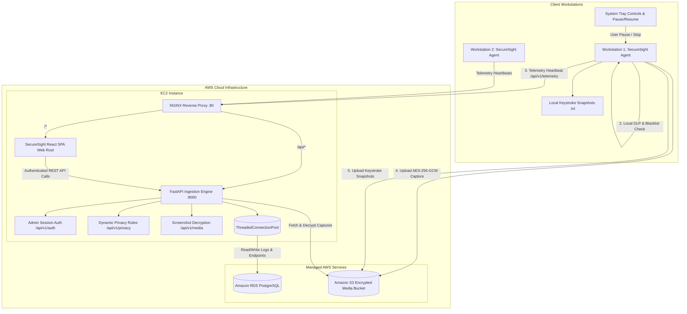

# SecureSight: Privacy-Centric Endpoint Observability & Security Platform

**SecureSight** is a cloud-native, privacy-first cybersecurity telemetry and endpoint observability platform engineered for enterprise compliance auditing and insider threat detection without compromising end-user privacy. Designed and optimized for cost-effective deployment on **AWS Free Tier** architecture.

---

## 📌 Executive Summary

Modern cybersecurity operations require continuous visibility into workstation activity, process execution, and data movement to prevent insider threats and data leakage. However, traditional monitoring tools often invade user privacy by capturing credentials, personal communications, and sensitive financial records without discrimination or explicit user consent.

**SecureSight** bridges this critical gap by implementing:
1. **Client-Side Data Loss Prevention (DLP) & Keystroke Redaction**: Sanitizes window titles, suppresses password fields, and redacts sensitive patterns (SSNs, payment cards, credentials) in local memory *before* telemetry or keystroke snapshots ever leave the workstation.
2. **Explicit Consent & Granular User Control**: Workstations are only monitored when explicit user consent is authorized, featuring instant pause/resume capability from the system tray and transparent session uptime tracking.
3. **End-to-End Client Encryption & Server Decryption**: Screen captures are encrypted locally with **AES-256-GCM** prior to direct Amazon S3 upload. Authenticated administrators inspect decrypted captures through a secure streaming proxy (`GET /api/v1/media/{capture_id}/image`).
4. **Keystroke Audit Snapshots & S3 Mirroring**: Structured audit files (`.txt`) are generated every 60 seconds of active typing, upon pause, kick, and session termination, with automatic mirroring to Amazon S3 under `keylogs/{endpoint_id}/`.
5. **Dynamic Privacy Rules Engine**: Real-time database-backed DLP rules managed dynamically via the dashboard with live regex testing sandbox and hot-reloading.
6. **Cloud-Native AWS Architecture**: High-throughput FastAPI ingestion engine hosted on **AWS EC2**, relational telemetry and audit storage on **Amazon RDS PostgreSQL** with connection pooling, and static frontend distribution via **NGINX**.

---

## 🏛️ System Architecture



### Core Architecture Components

| Component | Technology Stack | Responsibility |
| :--- | :--- | :--- |
| **Client Agent** | SecureSight Desktop App (Python 3.10+, PyQt6, PyAutoGUI, Cryptography, Requests) | Background telemetry collection, active window tracking, local DLP regex redaction, AES-256-GCM screen encryption, 1-minute keystroke audit snapshot generation, system tray controls. |
| **Backend API** | Python, FastAPI, Uvicorn, Psycopg2 Threaded Pool, Boto3, Pydantic | Ingestion of workstation telemetry, active endpoint heartbeat tracking, Amazon S3 presigned URL generation, server-side screenshot decryption proxy, dynamic privacy rules API, admin authentication. |
| **Relational Database** | Amazon RDS PostgreSQL | Persistent storage for users, endpoints, audit logs, media captures, connection history, privacy rules, and system telemetry metrics. |
| **Object Storage** | Amazon Simple Storage Service (S3) | Secure, encrypted cloud bucket storing encrypted client screen captures (`screenshots/`) and periodic keystroke audit files (`keylogs/`). |
| **Admin Dashboard** | SecureSight Dashboard (React 18, Vite, Tailwind CSS v4, Lucide Icons, Recharts) | Interactive security operations interface for fleet oversight, connection history, real-time activity streams, interactive Keylogs file viewer, dynamic privacy rules sandbox, and decrypted screenshot inspection. |
| **Reverse Proxy & Host** | NGINX, Ubuntu 24.04 LTS (AWS EC2) | SSL/TLS termination, HTTP reverse proxy routing `/api/` traffic to FastAPI, explicit UTF-8 character encoding, and high-performance static asset hosting for the React SPA. |

---

## 🛡️ Key Privacy & Security Highlights

- **Zero-Knowledge Cloud Redaction**: Plaintext passwords, SSNs, and payment card details are never transmitted over the network or stored in Amazon RDS. Redaction occurs exclusively in local workstation memory before transmission.
- **Keystroke Audit Snapshots**: Keystrokes are batched into cleanly timestamped `.txt` files every minute, cleared between cycles to prevent duplicate logging, with explicit notices when idle (`[No keystrokes recorded in this period.]`).
- **Authenticated Server-Side Screenshot Decryption**: Screenshot payloads stored in S3 remain encrypted at rest with AES-256-GCM. Decryption occurs strictly on-the-fly via authenticated admin sessions (`GET /api/v1/media/{capture_id}/image`).
- **Dynamic Privacy Rules Sandbox**: Administrators can define, update, toggle, and live-test regex redaction patterns without deploying code changes or restarting client agents.
- **Dynamic Heartbeat & Freshness Tracking**: Workstations that close their agents or lose connectivity automatically transition to **Offline** status within 35 seconds, clearing residual online counts.
- **Cascade Deletion & Re-Enrollment**: Deleted endpoints cleanly purge all associated foreign keys (telemetry, audit logs, captures, connection history) and can seamlessly re-enroll upon reconnecting using their persistent device fingerprint.
- **Thread-Safe Database Pooling**: Backend queries run through a resilient `ThreadedConnectionPool` with automatic transaction rollback protection on failures.

---

## 📚 Documentation Directory

Explore the complete technical documentation:

1. [**Client Agent Installation & Setup Guide**](agent-installation.md)
   - System requirements, installation instructions, configuring endpoints, interactive consent dialog, keystroke snapshot management, and system tray operations.
2. [**AWS Cloud Deployment & Infrastructure Guide**](aws-deployment-guide.md)
   - Step-by-step deployment on AWS EC2, Amazon RDS PostgreSQL schema deployment, Amazon S3 bucket security, Systemd service configuration, and NGINX reverse proxying.
3. [**Threat Model & Privacy Engineering Framework**](threat-model.md)
   - Comprehensive STRIDE threat assessment, defense-in-depth mitigations, client-side cryptographic design, and privacy enforcement.
4. [**Verification Demos & Testing Scenarios**](demos.md)
   - Hands-on testing procedures, DLP suppression verification, keylog snapshot inspection, offline disconnect detection, and end-to-end telemetry playback.

---

## ⚙️ Repository Structure

```
ITEC4810_Capstone/
├── agent/                 # SecureSight client desktop agent
│   ├── assets/            # SecureSight branding artwork & icons
│   ├── config/            # Blacklist definitions & endpoint configuration
│   ├── src/               # Core trackers, crypto engine, UI modals, tray manager
│   └── tests/             # Pytest test suite (36 passing tests)
├── backend/               # FastAPI backend ingestion and management API
│   ├── src/               # API routes, auth, media, privacy, DB connection pool
│   └── tests/             # Pytest endpoint validation tests (34 passing tests)
├── dashboard/             # SecureSight React dashboard
│   ├── public/branding/   # SecureSight official branding logos
│   ├── src/               # Components, views (Activity, Keylogs, Screenshots, etc.)
│   └── package.json       # Vite and frontend dependencies
├── database/              # PostgreSQL database initialization scripts
│   ├── schema.sql         # Relational schema (tables, foreign keys, indices)
│   └── seed.sql           # Default admin users, cleanup, and privacy rules
├── docs/                  # Project documentation (Jekyll & Markdown)
└── scripts/               # Automation & deployment shell scripts
    ├── deploy-ec2.sh      # Automated EC2 pull, build, and restart script
    └── init-rds.sh        # RDS PostgreSQL schema initialization script
```
