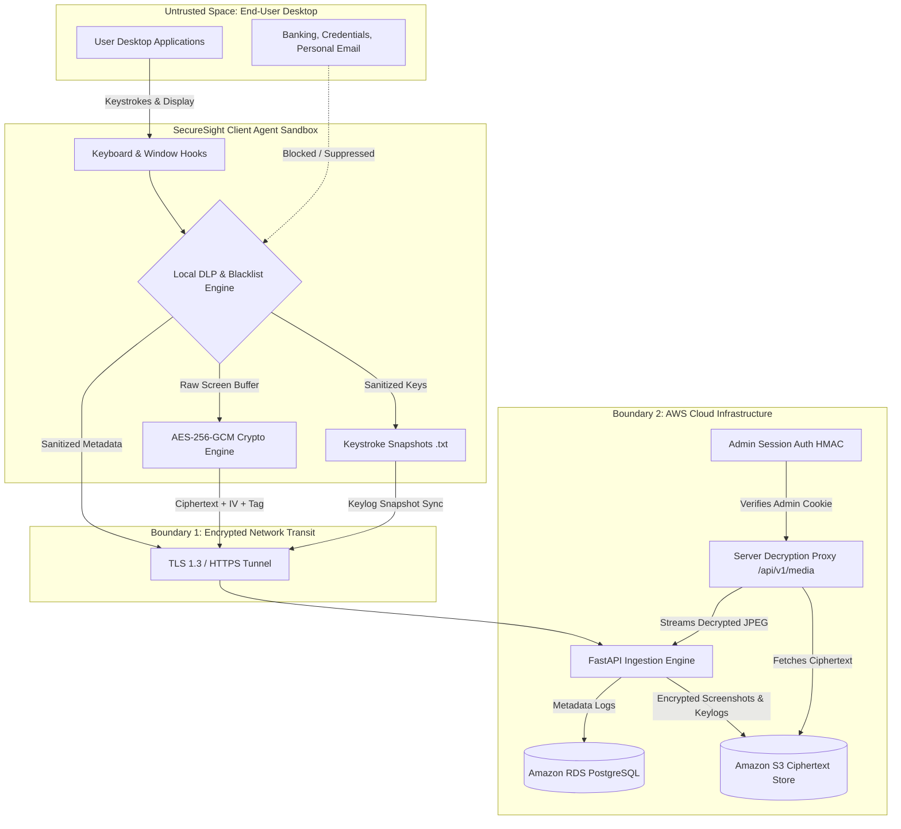

# Threat Model & Privacy Engineering Framework

This document outlines the **Threat Model**, **Data Protection Architecture**, and **Privacy Engineering Safeguards** implemented across the **SecureSight Endpoint Observability Platform**.

---

## 🎯 Security & Privacy Philosophy

Traditional Employee Monitoring Software (EMS) and endpoint detection agents operate under a surveillance-first paradigm: they indiscriminately record all keystrokes, capture desktop displays, and exfiltrate raw data to centralized cloud databases. This creates substantial legal liability, violates data privacy regulations (GDPR, CCPA/CPRA, HIPAA), and exposes enterprise organizations to credential leakage if cloud repositories are breached.

**SecureSight reverses this paradigm** through a **Privacy-First Zero-Knowledge Architecture**:
1. **Local-First Sanitization**: Sensitive data must be stripped at the endpoint *before* network serialization.
2. **User Consent & Autonomy**: Surveillance without explicit authorization is prohibited.
3. **Cryptographic Secrecy**: The cloud storage infrastructure never stores unencrypted visual media.
4. **Least-Privilege Media Access**: Decryption of captured displays is strictly performed on-the-fly through authenticated administrative sessions.

---

## 🔍 System Assets & Sensitivity Tiers

| Asset | Sensitivity | Protection Requirement |
| :--- | :--- | :--- |
| **User Keystrokes & Audit Snapshots** | High / PII | Aggregated into counts-per-minute (KPM). When diagnostic snapshots (`.txt`) are generated, all sensitive patterns (passwords, SSNs, credit cards) are redacted locally. Snapshots clear after each cycle and mirror securely to S3 under `keylogs/`. |
| **Desktop Screenshots** | High / Confidential | Screen buffers are redacted in-memory, encrypted with client-side **AES-256-GCM**, and stored as opaque ciphertext in S3. Decrypted strictly server-side for authenticated administrators. |
| **Credential / Banking Windows** | Critical | Evaluated against local blacklists and dynamic privacy rules. Complete capture suppression when sensitive processes or titles are active. |
| **Performance Telemetry** | Low / Operational | CPU%, RAM%, disk usage, active application name, and uptime streamed as standard operational metrics. |
| **Admin Database Credentials & Keys** | Critical | Stored in backend `.env` configuration, never committed to version control, hashed with PBKDF2. |

---

## 🌐 Trust Boundaries & Data Flow Diagram

---

## 🛡️ STRIDE Threat Assessment

The system has been evaluated against the **STRIDE** threat modeling framework:

### 1. Spoofing (Identity Impersonation)
- **Threat**: A rogue device attempts to inject malicious telemetry by spoofing an authorized endpoint ID.
- **Mitigations**:
  - The backend verifies endpoint registration state and matches hardware device fingerprints and MAC addresses.
  - Telemetry validation is enforced through strict Pydantic schemas.
  - Endpoints can be revoked instantly by administrators via the `/api/v1/endpoints/{id}/kick` control.

### 2. Tampering (Data Modification)
- **Threat**: Telemetry packets or screenshot files are intercepted and modified during transit.
- **Mitigations**:
  - All transport is conducted over TLS/HTTPS terminated at NGINX.
  - Screenshots use **AES-256-GCM authenticated encryption**, where any ciphertext alteration triggers a tag authentication failure upon decryption.
  - Telemetry payloads compute SHA-256 file hashes stored in PostgreSQL.

### 3. Repudiation (Disavowal of Actions)
- **Threat**: An administrative user denies viewing captured employee screens, or an employee disputes application usage.
- **Mitigations**:
  - Immutable audit logs in PostgreSQL record timestamped event entries (`timestamp`, `log_id`, `endpoint_id`, `active_app`, `filter_status`).
  - Screen access requests require authenticated administrator sessions (`edmt_admin_session` HMAC cookies).
  - Keystroke snapshot files are timestamped and preserved in S3 under `keylogs/{endpoint_id}/`.

### 4. Information Disclosure (Data Leakage)
- **Threat**: Passwords, SSNs, credit card numbers, or proprietary business data leak via screenshots or keystroke logs.
- **Mitigations**:
  - **Real-Time Regex DLP**: Built-in and database-backed dynamic pattern matchers sanitize credit card numbers (Luhn pattern), Social Security Numbers (SSN regex), and common password input patterns.
  - **Dynamic Privacy Rules Engine**: Administrators can define, toggle, and live-test regex redaction rules via `/api/v1/privacy/rules` without agent recompilation.
  - **Window Title Blacklist**: Matches banking websites (Chase, Bank of America, Wells Fargo), password managers (1Password, Bitwarden, KeePass), and credential dialogues.
  - **Privacy Suspension State**: Immediately pauses capture, zeroes keystrokes, and sets `filter_status = "Title_Blacklisted"`.
  - **Private S3 Buckets**: Public access is completely blocked (`BlockPublicAccess = True`). Screens remain encrypted with AES-256-GCM and are decrypted strictly through the authenticated backend proxy.

### 5. Denial of Service (DoS)
- **Threat**: A compromised agent floods the FastAPI backend with massive payloads or excessive screenshot uploads.
- **Mitigations**:
  - Rate limiting and fixed polling intervals (`10,000ms` cycle).
  - Screenshots are throttled to 1 per 6 cycles (`60 seconds`).
  - Threaded database connection pooling (`ThreadedConnectionPool`) prevents PostgreSQL connection exhaustion.
  - Automatic rollback on database exceptions protects transaction integrity.
  - S3 lifecycle policies automatically purge old captures after 30 days to prevent storage exhaustion.

### 6. Elevation of Privilege
- **Threat**: An unauthorized user accesses administrative controls to kick workstations or view sensitive audit data.
- **Mitigations**:
  - Role-Based Access Control (RBAC) separates **Administrator**, **Auditor**, and **User** roles in PostgreSQL.
  - Constant-time password validation with PBKDF2/SHA-256 and HMAC-SHA256 session cookies (`HttpOnly`, `SameSite=Lax`).
  - The agent architecture is strictly **read-only telemetry**; the backend cannot execute remote code or arbitrary shell commands on client endpoints.

---

## ⚖️ Privacy Principles & Compliance Alignment

### Explicit Informed Consent (GDPR Article 6 / CCPA)
Workstations cannot be monitored invisibly. SecureSight:
1. Presents an interactive **Consent Authorization Modal** before recording any data.
2. Displays a persistent SecureSight shield icon in the Windows/macOS System Tray.
3. Provides an immediate **"Pause Monitoring Consent"** action, placing the user in control of privacy during personal breaks.
4. Generates an explicit `_pause.txt` snapshot and transitions the dashboard status tag to `Paused`.

### Data Minimization (GDPR Article 5)
Only metrics strictly required for security compliance are collected:
- Aggregate keystroke frequency (KPM) rather than continuous raw keystroke streams.
- Periodic `.txt` snapshots contain only keys typed during that 60-second window, clearing the buffer immediately after write.
- If no typing occurred, an explicit empty-state notice is recorded rather than duplicating prior input.
- Active foreground application and window title (redacted if blacklisted).
- CPU and RAM performance consumption.
